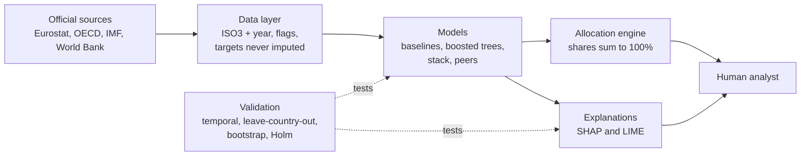

<div align="center">

# GovAllocXAI

### An open benchmark of explainable machine learning for predicting how governments divide their budgets

[](https://doi.org/10.5281/zenodo.24248315)
[](https://doi.org/10.5281/zenodo.24255442)
[](LICENSE)
[](https://doi.org/10.5281/zenodo.24248315)


**[Live website](https://govallocxai-xi.vercel.app)** · **[Dataset (Zenodo)](https://doi.org/10.5281/zenodo.24248315)** · **[Dataset (Kaggle)](https://www.kaggle.com/datasets/pranavchaudhari24/govalloc-cofog-government-spending-by-function)** · **[Code archive (Zenodo)](https://doi.org/10.5281/zenodo.24255442)**

*Pranav S. Chaudhari · Aditi H. Joshi · Gaurav M. Jaypatre · Digvijay P. Birajdar*
Department of Computer Engineering, Pimpri Chinchwad College of Engineering, Pune, India

</div>

> **The tool gives a reference point and a second opinion for a human budget analyst. It does not forecast, it does not prove cause and effect, and it never replaces the decision.**

---

## Contents
1. [What is this project?](#1-what-is-this-project) · 2. [Highlights](#2-highlights) · 3. [How it works](#3-how-it-works) · 4. [The data](#4-the-data) · 5. [Methods](#5-methods) · 6. [Key results](#6-key-results) · 7. [The web tool](#7-the-web-tool) · 8. [Requirements](#8-requirements) · 9. [Quick start](#9-quick-start) · 10. [Repository map](#10-repository-map) · 11. [Papers and documentation](#11-papers-and-documentation) · 12. [Deployment](#12-deployment) · 13. [Limitations and responsible use](#13-limitations-and-responsible-use) · 14. [Cite, licence, changelog](#14-cite-licence-changelog)

---

## 1. What is this project?
Every government splits its spending among health, education, defence, social protection and other functions. Most of the time the split is last year's split, adjusted a little. This project asks two honest questions:

1. **How much can machine learning add to last year's split?** (the *annual update* setting)
2. **What can comparable economies and model explanations tell an analyst when there is no last year?** (the *cold-start* setting)

We answer them on **official statistics only** (Eurostat, OECD, IMF, World Bank), with careful baselines, leakage controls and statistics, and we report the **negative results** too. The repository contains everything: the dataset builder, 29 numbered experiment scripts, the result files behind every number in our papers, three LaTeX papers, a FastAPI backend and an interactive React website.

**Why it exists.** Our first version reported R² above 0.99. A forensic audit showed this was an artefact: eleven of the fifteen target columns of that earlier semi-synthetic dataset were exact multiples of one series. We rebuilt the whole project on real data and kept the audit as a documented lesson. The old dataset is preserved, clearly marked, in `data/dataset_old/`.

## 2. Highlights
- **Open dataset, GovAlloc-COFOG v1.0:** harmonised government spending shares by COFOG function for up to **217 economies, 2000-2024**, with provenance and imputation flags ([DOI](https://doi.org/10.5281/zenodo.24248315)).
- **Honest benchmark:** persistence and peer baselines, temporal / leave-country-out / leave-region-out splits, cluster-bootstrap intervals, Holm-corrected comparisons, five seeds.
- **Explanations that are tested, not just shown:** SHAP and LIME agreement, stability, deletion faithfulness, and a synthetic ground-truth test.
- **Interactive website:** pick a country, see the reference split, budget flow, peers, uncertainty ranges and the main factors, with SDG mapping.
- **Fully reproducible:** every number in the papers is generated from `results/` by scripts; text, tables and figures cannot drift apart.
- **Three papers included:** benchmark (journal), conference version, and a data paper.

## 3. How it works


**Two settings.**
| Setting | Input | Baseline to beat |
|---|---|---|
| **Annual update** | last year's split + this year's indicators | "same split as last year" (persistence) |
| **Cold start** | indicators only (no history) | income-group average split |

The metric is the **total-variation distance (TVD)**: the percentage of the whole budget that would have to be moved to turn one split into the other. Lower is better.

## 4. The data
| Panel | What | Size |
|---|---|---|
| **A16** | 16 COFOG functions (Eurostat, OECD) | 825 complete country-years, 36 economies |
| **A10** | 10 COFOG divisions (adds IMF) | 1,526 country-years, 85 economies |
| **B** | official World Bank sector series (health, education, defence, R&D) | 4,995 country-years, 211 economies |
| **Master** | features + every target + flags + legacy columns | 5,450 rows x 217 columns |

- **Targets are official published statistics and are never imputed.** Feature values that were filled (short interpolation, then peer-group median) carry a per-cell flag (`imp_*`).
- Shares are percentages of total general-government expenditure and sum to 100 per row. The data are **executed (outturn)** spending, not planned budgets.
- Files: `data/dataset_new/govalloc_cofog_*.csv`; description and column dictionary in [`docs/guides/04_dataset_card.md`](docs/guides/04_dataset_card.md). Providers and their terms: World Bank (CC BY 4.0), Eurostat, OECD, IMF.

## 5. Methods
- **Learners:** XGBoost, LightGBM, CatBoost, random forest, ridge; a delta learner for the annual setting; a non-negative-least-squares **stack**; nearest-economies average; Dirichlet regression, MLP and FT-Transformer baselines; econometric panel baselines.
- **Compositional handling:** centred log-ratio targets; exact bounded-simplex projection (with an SLSQP cross-check) so allocations always sum to 100 and respect policy bounds.
- **Uncertainty:** split-conformal intervals (global and by income group) and an applicability score showing how unusual a country is.
- **Explainability:** TreeSHAP, the reference `lime` package, KernelSHAP for the blend, plus the tests listed above.
- **Rigor:** nested weight fitting, grouped cross-validation, cluster bootstrap by country, five seeds, Holm correction, fairness audit by income group.

## 6. Key results
| Finding | Number |
|---|---|
| Annual update: persistence vs learned correction | 3.62 pp vs 3.48 pp TVD; gain 0.140 pp (95% CI 0.025-0.277) for the pre-declared seed, **0.12 pp on average and significant for only 1 of 5 seeds** |
| Cold start, panel A10: stack vs income-group mean | 13.77 vs 15.01 pp; gain 1.26 pp (CI 0.68-1.84), **Holm p = 0.0008**; the 8-nearest-economies average is as good (1.25 pp) |
| Cold start, panel A16 | stack gain 0.81 pp does **not** survive correction (p = 0.060) |
| Predictable in unseen economies | health R² 0.63 and R&D 0.60 (peer mean 0.31 and 0.25); defence 0.12 |
| Errors by income | 33.4 pp for low-income vs 11.4 pp for high-income economies (only 3 low-income economies, so exploratory) |
| SHAP vs LIME | Spearman 0.59, top-5 Jaccard 0.48, sign agreement 0.85; resetting top-3 SHAP features moves predictions 3.1x more than random features |
| Shock years (2020) | only weakly anticipated; human judgment must dominate |

**Message:** last year's allocation is very hard to beat; peers help most for health and R&D when there is no history; explanations agree mainly on direction.

## 7. The web tool
Live at **https://govallocxai-xi.vercel.app**. One input is needed: choose a country.

- **Budget Explorer:** reference split (donut and ranked bars), **budget-flow diagram** (total budget to areas to SDGs), difference from last year (when history exists), comparison with the most similar economies, **uncertainty ranges**, the **main factors** (SHAP, optional LIME), and a sortable table with amounts.
- **SDG View:** how the split maps to the UN Sustainable Development Goals (an illustrative cross-walk).
- **Advanced options:** other year, recession / stagflation / severe-stress what-ifs, your own total budget.
- **Guide and glossary** explain every unfamiliar term; the interface chooses the model and level of detail (16 or 10 areas) automatically.
- Default results for all 218 economies are **pre-computed static files**, so the page opens instantly even on slow connections; the API is only needed for advanced options.

## 8. Requirements
| Part | Needs |
|---|---|
| **Web backend** | Python 3.12 or 3.13; `pip install -r backend/requirements.txt` (FastAPI, uvicorn, pandas, scikit-learn, XGBoost, CatBoost, SHAP, LIME, scipy); about 400 MB RAM |
| **Website** | Node.js 18 or newer (tested with 24); packages in `frontend/package.json` (React 18, Vite 5, Tailwind, Recharts) |
| **Research pipeline** | Python 3.13 recommended; `pip install -r requirements-research.txt` (adds LightGBM, Optuna, PyTorch CPU, matplotlib, openpyxl); 12 CPU cores and about 16 GB RAM make the full pipeline comfortable |
| **Papers** | pdfLaTeX (Overleaf, TeX Live or Tectonic); packages are standard (`elsarticle` is not needed) |
| **Internet** | only to re-download the raw data (`pipeline/01-02`); the downloaded files are already in `data/raw/` |

## 9. Quick start
**Run the website locally** (two terminals)
```bash
python -m pip install -r backend/requirements.txt
python -m uvicorn backend.main:app --port 8000
```
```bash
cd frontend
npm install
npm run dev
```
Open http://localhost:5173. The server loads its models in the background (about 2-5 minutes the first time).

**Run the tests:** `python -m pytest backend/tests -q`

**Reproduce the research**
```bash
python -m pip install -r requirements-research.txt
python pipeline/03_build_dataset.py            # rebuild data/dataset_new from data/raw
python pipeline/04_experiments_main.py         # then 05 ... 25 as needed
python pipeline/27_make_figures_tables.py      # figures, tables and LaTeX macros for the papers
python tools/build_overleaf_zips.py            # Overleaf zips in papers/overleaf_zips/
```
Details per script are in `docs/methods_and_experiments_log.md`. Note: one script (`09`) is not bit-for-bit reproducible; see [`docs/guides/05_known_issues_and_future_work.md`](docs/guides/05_known_issues_and_future_work.md).

## 10. Repository map
```
GovAllocXAI/
├── README.md  CHANGELOG.md  CITATION.cff  LICENSE  render.yaml  vercel.json
├── data/
│   ├── raw/             official downloads used by the pipeline
│   ├── dataset_new/     the released GovAlloc-COFOG files (govalloc_cofog_*.csv)
│   └── dataset_old/     the original semi-synthetic dataset, kept only for the audit
├── pipeline/            numbered scripts 01-29: fetch, build, experiments, explainability, figures
├── results/             one folder per experiment (01_legacy_audit ... 19_annual_seed_robustness)
├── papers/              benchmark journal paper, conference paper, dataset paper, shared tables/figures,
│                        overleaf_zips/ (ready to upload)
├── backend/             FastAPI service (service.py: stack, SHAP/LIME, intervals, peers)
├── frontend/            React website (+ public/precomputed results for every economy)
├── tools/               LaTeX lint, Overleaf zip builder, reference audit, Zenodo/Kaggle packages
├── literature/          base papers and related-work PDFs with an index
└── docs/                guides/ (run, release, venues, data card), audits/ (reviews, reference checks),
                         templates/ (cover letters, submission statements), experiment and literature logs
```

## 11. Papers and documentation
- **Papers** (`papers/`): *GovAllocXAI: A Benchmark of Explainable Machine Learning for Predicting Functional Government Expenditure Shares from Official Multi-Country Data* (journal and 6-page conference versions) and the data paper *GovAlloc-COFOG: Harmonised General-Government Expenditure by COFOG Function with Provenance Flags*. Upload the zips in `papers/overleaf_zips/` to Overleaf and compile with pdfLaTeX.
- **Guides** (`docs/guides/`): run the website, GitHub and Zenodo release, deploying, venues, dataset card, Zenodo upload.
- **Audits** (`docs/audits/`): the audit of the original benchmark, a readiness audit, a fairness audit, reference and citation checks, and the independent review panels.
- **Logs:** [`docs/methods_and_experiments_log.md`](docs/methods_and_experiments_log.md), [`docs/literature_and_novelty.md`](docs/literature_and_novelty.md).
- **Submission templates** (`docs/templates/`): cover letters and ready-to-paste declarations.

## 12. Deployment
Frontend on **Vercel** (root `vercel.json` builds `frontend/`), backend on **Render** (`render.yaml`; free plan sleeps after 15 idle minutes and needs a few minutes to wake). Steps and the exact service names are in [`docs/guides/06_deploy_render_vercel.md`](docs/guides/06_deploy_render_vercel.md).

## 13. Limitations and responsible use
- Coverage is centred on Europe and the OECD; only three low-income economies are in panel A10, so low-income findings are exploratory.
- The annual setting is a **nowcast**: it uses same-year indicators that are published with a lag. Data are executed spending, not proposals.
- Explanations are **associations**, not causes; shock scenarios are sensitivity checks, not forecasts.
- The website shows in-sample fits for economies that are part of the training data; the papers report leave-one-country-out errors.
- **Do not apply any number automatically.** Recommendations inherit historical biases and need human review.
- Open items for future work are listed in [`docs/guides/05_known_issues_and_future_work.md`](docs/guides/05_known_issues_and_future_work.md). Generative AI (Anthropic's Claude) assisted with code and drafting; this is declared in the papers.

## 14. Cite, licence, changelog
- **Cite the dataset:** Chaudhari, Joshi, Jaypatre, Birajdar (2026). *GovAlloc-COFOG v1.0.* Zenodo. https://doi.org/10.5281/zenodo.24248315
- **Cite the code:** https://doi.org/10.5281/zenodo.24255442 (or use GitHub's "Cite this repository", from `CITATION.cff`).
- **Licences:** code MIT ([`LICENSE`](LICENSE)); our harmonised data CC BY 4.0, subject to the terms of the original providers.
- **Changes since the archived release:** see [`CHANGELOG.md`](CHANGELOG.md).

<div align="center">Made at Pimpri Chinchwad College of Engineering, Pune.</div>
